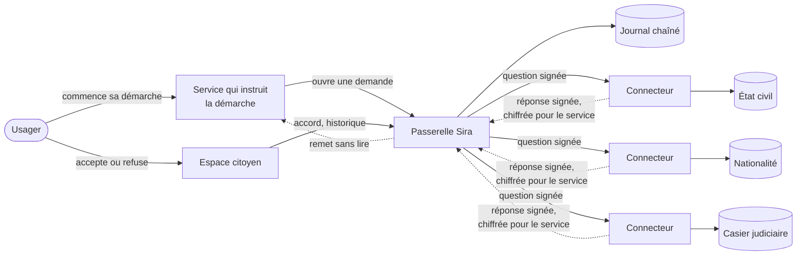

# Sira

Sira est un socle libre qui permet aux administrations du Burkina Faso de s'échanger les informations qu'elles détiennent déjà, avec l'accord de la personne concernée, plutôt que de les lui redemander. « Sira » signifie « la route » en dioula : ce sont les informations qui font le chemin, pas l'usager.

## Pourquoi

Prenons Aïcha, qui veut s'inscrire à un concours direct de la fonction publique. Pour prouver qu'elle remplit les conditions, on lui demande un extrait d'acte de naissance, un certificat de nationalité et un bulletin n° 3 du casier judiciaire. Elle passe donc par plusieurs guichets, attend que chaque pièce soit prête, puis dépose des copies au service des concours. Pourtant, chacune de ces informations existe déjà dans un registre de l'État.

Le service des concours n'a d'ailleurs pas besoin de sa date de naissance, ni de sa filiation, ni du contenu de son casier. Il a besoin de quatre réponses : est-elle majeure, a-t-elle 35 ans au plus, est-elle burkinabè, son casier est-il vierge.

## Ce que fait Sira

Avec Sira, Aïcha commence sa démarche sur le site du concours et choisit de continuer avec Sira. Elle se connecte avec son identifiant unique et un code reçu sur son téléphone, puis voit sur un seul écran qui demande quoi, et dans quel but. Si elle accepte, la passerelle pose les quatre questions aux registres concernés. Chaque registre, par son connecteur, répond par oui ou par non, signe sa réponse et la chiffre pour le seul service des concours : la passerelle la transporte sans pouvoir la lire.

Chaque consultation est inscrite dans un journal chaîné qu'Aïcha peut lire depuis son espace, où elle peut aussi retirer un accès qu'elle a donné. Si l'un des registres est en panne au moment de la démarche, le dossier est enregistré quand même et se complète tout seul quand le registre revient.



Chaque administration garde son registre chez elle. Elle y place un connecteur Sira, qui applique sa propre politique : tout ce que la politique ne liste pas est refusé, même si la passerelle le demande. Sira ne remet jamais l'identifiant unique de la personne à un service, seulement un pseudonyme propre à ce service. Un service peut transmettre l'identifiant que l'usager a saisi lui-même chez lui, pour le désigner : Sira vérifie alors que c'est bien cette personne qui donne l'accord. Le service de démonstration ne le conserve pas.

| Ce que demande le sujet                                         | Où le voir dans Sira                                                        |
| --------------------------------------------------------------- | --------------------------------------------------------------------------- |
| Les cinq couches, chacune avec son contrat OpenAPI et ses tests | Tableau ci-dessous                                                          |
| Trois démarches de bout en bout, sans pièce à fournir           | Concours direct, bourse d'études, immatriculation d'un commerçant           |
| Déploiement en une commande                                     | `scripts/sira demo`                                                         |
| Consentement explicite, minimisation, traçabilité               | Écran d'accord de l'espace citoyen, réponses « oui ou non », journal chaîné |

| Couche                       | Dossier                                                             | Contrat                                                                            | Tests                                                                                               |
| ---------------------------- | ------------------------------------------------------------------- | ---------------------------------------------------------------------------------- | --------------------------------------------------------------------------------------------------- |
| Registres                    | [`registres/`](registres/README.md)                                 | [`registres/openapi.yaml`](registres/openapi.yaml)                                 | `./mvnw -pl registres/serveur -am verify`                                                           |
| Passerelle d'échange         | [`passerelle/`](passerelle/README.md)                               | [`passerelle/openapi.yaml`](passerelle/openapi.yaml)                               | `./mvnw -pl passerelle/serveur -am verify`                                                          |
| Consentement et minimisation | [`consentement-minimisation/`](consentement-minimisation/README.md) | [`consentement-minimisation/openapi.yaml`](consentement-minimisation/openapi.yaml) | `./mvnw -pl consentement-minimisation/consentement,consentement-minimisation/connecteur -am verify` |
| Journal de traçabilité       | [`journal/`](journal/README.md)                                     | [`journal/openapi.yaml`](journal/openapi.yaml)                                     | `./mvnw -pl journal -am verify`                                                                     |
| Espace usager                | [`espace-usager/`](espace-usager/README.md)                         | [`espace-usager/openapi.yaml`](espace-usager/openapi.yaml)                         | `./mvnw -pl espace-usager/serveur -am verify`                                                       |

Les trois démarches, vues par la personne :

| Démarche                                | Ce que le service reçoit, sans aucune pièce à fournir                                                                                                                   |
| --------------------------------------- | ----------------------------------------------------------------------------------------------------------------------------------------------------------------------- |
| Concours direct de la fonction publique | Nom et prénoms, lieu de naissance, « 18 ans ou plus : oui », « 35 ans au plus : oui », « nationalité burkinabè : oui », « casier vierge : oui », attestation de diplôme |
| Bourse d'études                         | Identité, filiation, nationalité, baccalauréat (obtenu, moyenne, établissement), attestation de diplôme, relevé de notes                                                |
| Immatriculation d'un commerçant         | Identité, filiation, extrait d'acte de naissance, certificat de nationalité, « casier vierge : oui »                                                                    |

### Les principes, en une minute

1. **Les données restent chez chaque administration.** Sira ne copie aucun registre. Il pose une question au registre, au moment où on en a besoin.
2. **Rien ne part sans l'accord de la personne.** Elle voit qui demande, quoi, pourquoi et pour combien de temps, puis elle accepte ou refuse.
3. **Le strict nécessaire.** Souvent un simple oui ou non : le service sait que la personne a 18 ans, sans connaître sa date de naissance.
4. **Deux verrous.** Une habilitation approuvée par une deuxième personne côté Sira, et la politique du connecteur côté registre : une information ne sort que si les deux l'autorisent.
5. **Personne ne lit en chemin.** La réponse est signée par le registre et chiffrée pour le seul service destinataire ; la passerelle la transporte sans pouvoir la lire.
6. **Tout est tracé.** Chaque consultation est inscrite dans un journal chaîné, impossible à modifier sans que cela se voie. La personne le lit depuis son espace et peut retirer un accès.
7. **Une panne ne bloque pas la démarche.** Si un registre ne répond pas, la question attend dans une file et repart toute seule à son retour.

## Essayer en cinq minutes

Il faut Docker avec le greffon Compose dans une version récente (les fichiers utilisent `--wait` et les montages de volume avec `subpath`), ainsi que bash et curl. Node.js 24 et Java 21 ne servent qu'à lancer les tests.

```sh
scripts/sira demo
```

Le premier lancement construit toutes les images et prend nettement plus de cinq minutes ; les suivants réutilisent le cache. Le script crée `deploiement/.env` à partir de `deploiement/.env.example`, génère au premier démarrage l'autorité de certification, les certificats et les secrets dans des volumes Docker (jamais dans le dépôt), attend que tout soit sain, puis affiche les adresses. Le seul port publié est `127.0.0.1:8600`, réglable par `SIRA_PORT`.

- http://concours.sira.localhost:8600 : le service des concours, pour faire le parcours d'Aïcha. Les démarches de bourse d'études (`bourses`) et d'immatriculation d'un commerçant (`entreprises`) suivent le même modèle.
- http://telephone.sira.localhost:8600 : le téléphone de démonstration, où arrivent les codes de connexion.
- http://citoyen.sira.localhost:8600 : l'espace citoyen, pour voir qui a consulté quoi et retirer un accès.
- http://console.sira.localhost:8600 : la console d'administration du socle.
- http://etat-civil.sira.localhost:8600, ainsi que `nationalite`, `casier` et `diplomes` : les registres simulés, avec leur fiche des personnes et un panneau pour provoquer une panne.

Pour le parcours d'Aïcha, connectez-vous avec l'identifiant `990048217350` et recopiez le code affiché sur le téléphone simulé. Les six citoyens fictifs sont dans `identite/demo/sira-citoyens-users-0.json`. Les comptes de la console et des agents utilisent un mot de passe commun, et la console demande en plus un code TOTP :

```sh
scripts/sira comptes
```

Cette commande affiche le mot de passe commun, généré sur votre poste au premier démarrage. Les comptes de la console n'ont pas de graine TOTP connue d'avance : à leur première connexion, Keycloak montre un QR code à scanner avec Google Authenticator ou Microsoft Authenticator, une seule fois, comme pour un vrai compte. `scripts/sira totp-reinitialiser <instructeur|autorite|auditeur>` le fait réapparaître. La pile de démonstration a des comptes à mot de passe connu : ne la lancez jamais sur une machine joignable par d'autres. `scripts/sira aide` liste les autres commandes ; `scripts/sira reinitialiser` efface tout pour repartir de zéro.

Sous Windows, lancez les commandes depuis Git Bash (`bash scripts/sira demo`), avec Docker Desktop démarré. Si la mémoire manque pendant la première construction, construisez les images une par une : voir [deploiement/README.md](deploiement/README.md).

### Les comptes pour essayer

| Où                          | Identifiant                                                                  | Comment se connecter                                                                                    |
| --------------------------- | ---------------------------------------------------------------------------- | ------------------------------------------------------------------------------------------------------- |
| Espace citoyen et démarches | `990048217350` (Aïcha KABORÉ)                                                | Code à 6 chiffres affiché sur http://telephone.sira.localhost:8600                                      |
| Console d'administration    | `instructeur@sira.example`, `autorite@sira.example`, `auditeur@sira.example` | Mot de passe commun (`scripts/sira comptes`), puis QR code à scanner une fois avec Google Authenticator |
| Registres et services       | `agent.<code>@sira.example`, par exemple `agent.etat-civil@sira.example`     | Même mot de passe commun, puis QR code à la première connexion                                          |

Rôles de la console : l'**instructeur** prépare les habilitations, l'**autorité** les approuve ou les refuse (jamais un dossier qu'elle a préparé), l'**auditeur** lit seulement. Dans chaque registre et chaque service, l'administrateur gère ses propres agents depuis les menus « Utilisateurs » et « Rôles ».

## Comment le dépôt est rangé

Le dépôt contient deux choses qu'il faut bien distinguer : le socle, qu'une administration réutiliserait tel quel, et une simulation qui l'entoure de services, de registres et de personnes fictifs pour qu'on puisse l'essayer. Le socle ne dépend jamais de la simulation, et `scripts/sira demarrer` le lance seul, sans aucune donnée fictive.

Le socle :

- [`passerelle/`](passerelle/README.md) : le point de passage entre les services et les registres, et le kit Java qu'un service ajoute pour s'y raccorder.
- [`consentement-minimisation/`](consentement-minimisation/README.md) : les accords du citoyen et le connecteur posé devant chaque registre.
- [`journal/`](journal/README.md) : le journal des consultations, en ajout seul et chaîné.
- [`resilience/`](resilience/README.md) : ce qui permet de tenir quand un registre ne répond plus.
- [`espace-usager/`](espace-usager/README.md) : le serveur de l'espace citoyen.
- [`console/`](console/README.md) : le serveur de la console d'administration.
- [`commun/`](commun/README.md) : les briques Java partagées (mTLS, signatures et chiffrement, connexion OIDC, erreurs).
- [`identite/`](identite/README.md) : Keycloak, ses royaumes, son thème et la connexion par code.
- [`pki/`](pki/README.md) : l'autorité de certification interne et le générateur de secrets.
- [`interfaces/`](interfaces/README.md) : les écrans Angular ; `interfaces/socle/` pour le socle.
- [`deploiement/`](deploiement/README.md) : les fichiers Docker Compose et la configuration des conteneurs.

La simulation :

- [`registres/`](registres/README.md) : quatre registres fictifs, leurs données et les politiques de leurs connecteurs.
- [`guichet-agent/`](guichet-agent/README.md) : trois services fictifs qui instruisent une démarche chacun.
- `passerelle/amorcage-demo/`, `identite/demo/` et `interfaces/demo/` : le référentiel, les comptes et les écrans de démonstration.
- `deploiement/compose.demo.yaml` et les fichiers `*.demo.conf` : leur déploiement.

Enfin, [`scripts/sira`](scripts/sira) est le point d'entrée de toutes les commandes, et [`tests/e2e/`](tests/e2e/README.md) contient les tests de bout en bout.

## Raccorder un registre

Une administration ne modifie pas son registre pour rejoindre Sira. Elle installe un connecteur, lui décrit en YAML comment lire une fiche dans son registre et ce qu'elle accepte d'en exposer, puis le membre, le registre, les questions et l'habilitation se déclarent depuis la console ; l'habilitation n'est active qu'une fois approuvée par une autre personne que celle qui l'a préparée. La commande `scripts/sira etranger` la rejoue de bout en bout sur la pile de démonstration, avec un registre volontairement différent (autre langage, autres noms de champs, clé d'API).

## Sécurité

Tous les échanges entre machines passent en TLS mutuel, et l'identité d'un membre est celle de son certificat. Une requête de la passerelle vers un connecteur est signée et ne vaut que soixante secondes, une seule fois. Les comptes des citoyens, des administrateurs et des agents vivent dans des royaumes Keycloak séparés, et le navigateur ne reçoit jamais de jeton. Aucun secret n'est versionné : tout est généré au premier démarrage.

Pour signaler une faille, voir [SECURITY.md](SECURITY.md).

## Tests

```sh
./mvnw verify            # tests Java et contrôle du format (Docker requis, pour Testcontainers)
scripts/sira verifier    # sur la pile qui tourne : ce qui doit rester fermé l'est
scripts/sira tester      # tests de bout en bout dans un navigateur (Playwright)
```

`scripts/sira verifier` et `scripts/sira tester` se connectent pour de vrai avec les comptes fictifs et consomment donc des codes de connexion ; un citoyen fictif en reçoit au plus dix par heure.

## Contribuer

Les contributions sont les bienvenues, du rapport d'anomalie au raccordement d'un nouveau registre. [CONTRIBUTING.md](CONTRIBUTING.md) explique comment préparer son poste, les quelques règles du projet et ce qu'il faut vérifier avant de proposer un changement.

## Licence

Sira est publié sous la [Licence publique de l'Union européenne, version 1.2](LICENSE) (EUPL-1.2).

## Auteurs

Sira est développé par l'équipe codeforchange de l'IBAM, à Ouagadougou : Landry Ezéïkiel OUARMA, Abdoul Razack OUEDRAOGO et Laodou Othniela KY.
