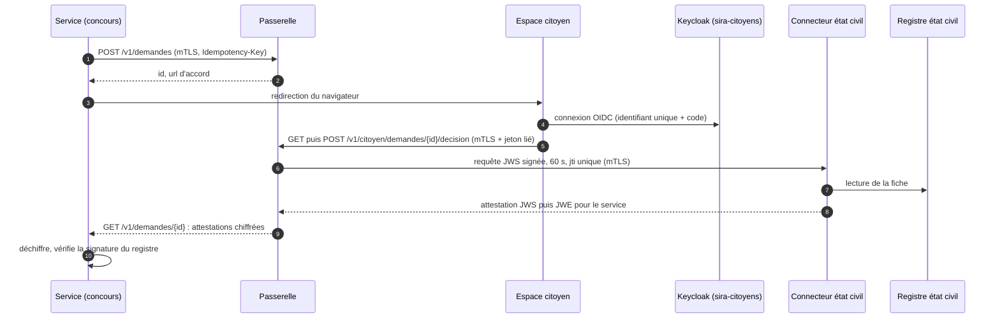

# Suivre une demande de bout en bout

Prenons une inscription au concours direct. Le portail du concours a besoin de savoir si la
candidate est majeure. Il ouvre une demande auprès de Sira et envoie la candidate sur son espace
citoyen ; elle se connecte, lit ce qui est demandé et accepte. La passerelle interroge alors le
connecteur de l'état civil, qui lit la fiche, évalue « âge au moins 18 » et renvoie une
attestation signée et chiffrée pour le seul service du concours. Le portail l'ouvre et lit
« oui ». La date de naissance n'a jamais quitté l'état civil.

Cette page suit ce chemin dans le code, dans l'ordre où la demande le traverse. Gardez le dépôt
ouvert à côté : chaque étape donne les fichiers à lire. Les règles communes (formats, codes
d'erreur, cryptographie) sont dans le [contrat](architecture/CONTRAT.md), les routes dans
[API.md](architecture/API.md).

## Vue d'ensemble

## Étape par étape

### 1. Le service ouvre une demande

| Fichier | Rôle |
|---|---|
| [`guichet-agent/serveur/.../parcours/ParcoursControleur.java`](../guichet-agent/serveur/src/main/java/bf/sira/demo/service/parcours/ParcoursControleur.java) | Reçoit le choix de passer par Sira sur le portail du concours. |
| [`guichet-agent/serveur/.../demandes/SuiviDemandes.java`](../guichet-agent/serveur/src/main/java/bf/sira/demo/service/demandes/SuiviDemandes.java) | Appelle `sira.creerDemande(...)` avec une clé d'idempotence, puis `sira.lireDemande(...)`. |
| [`passerelle/kit/.../ClientSira.java`](../passerelle/kit/src/main/java/bf/sira/kit/ClientSira.java) | Kit réutilisable par tout service. Il appelle la passerelle en mTLS. |
| [`commun/.../mtls/ClientsMtls.java`](../commun/src/main/java/bf/sira/commun/mtls/ClientsMtls.java) | Client HTTP en TLS 1.3 avec certificat client. |

### 2. La passerelle enregistre la demande

| Fichier | Rôle |
|---|---|
| [`passerelle/serveur/.../config/Securite.java`](../passerelle/serveur/src/main/java/bf/sira/passerelle/config/Securite.java) | Qui a le droit d'appeler quelle route : seul un membre actif au rôle `SERVICE` ouvre une demande. L'espace citoyen et la console sont reconnus à leur certificat. |
| [`commun/.../identite/SecuriteMembres.java`](../commun/src/main/java/bf/sira/commun/identite/SecuriteMembres.java) | Tire l'identité Sira du SAN du certificat validé par TLS, jamais d'un en-tête ni du corps. |
| [`passerelle/serveur/.../demandes/DemandesControleur.java`](../passerelle/serveur/src/main/java/bf/sira/passerelle/demandes/DemandesControleur.java) | `POST /v1/demandes`, `GET /v1/demandes/{id}`. |
| [`passerelle/serveur/.../demandes/Demandes.java`](../passerelle/serveur/src/main/java/bf/sira/passerelle/demandes/Demandes.java) | Vérifie l'habilitation du service pour cette démarche (sinon `HABILITATION_ABSENTE`), crée la demande `EN_ATTENTE_ACCORD`. |
| [`passerelle/serveur/.../referentiel/Habilitations.java`](../passerelle/serveur/src/main/java/bf/sira/passerelle/referentiel/Habilitations.java) | Habilitations approuvées par l'autorité. |

### 3. Le citoyen se connecte

| Fichier | Rôle |
|---|---|
| [`identite/extension/.../IdentifiantAuthenticator.java`](../identite/extension/src/bf/sira/identite/IdentifiantAuthenticator.java) | Extension Keycloak du royaume `sira-citoyens` : identifiant unique, puis code à usage unique. |
| [`identite/extension/.../CodeUsageUnique.java`](../identite/extension/src/bf/sira/identite/CodeUsageUnique.java) | Génère, envoie et vérifie le code. `transmettre` est le point où brancher une passerelle SMS. |
| [`commun/.../oidc/ConnexionOidc.java`](../commun/src/main/java/bf/sira/commun/oidc/ConnexionOidc.java) | Client OIDC confidentiel par certificat (`tls_client_auth`), PKCE S256. Le jeton reste côté serveur. |
| [`espace-usager/serveur/.../relais/RoutesCitoyen.java`](../espace-usager/serveur/src/main/java/bf/sira/espacecitoyen/relais/RoutesCitoyen.java), [`Relais.java`](../espace-usager/serveur/src/main/java/bf/sira/espacecitoyen/relais/Relais.java) | Liste fermée des routes relayées de `/api/**` vers `/v1/citoyen/**`, avec le jeton lié au certificat. |

### 4. Le citoyen décide

| Fichier | Rôle |
|---|---|
| [`consentement-minimisation/consentement/.../CitoyenControleur.java`](../consentement-minimisation/consentement/src/main/java/bf/sira/consentement/CitoyenControleur.java) | Routes `/v1/citoyen/**`. |
| [`consentement-minimisation/consentement/.../Accords.java`](../consentement-minimisation/consentement/src/main/java/bf/sira/consentement/Accords.java) | Décision unique et dans le délai. Le code de vérification est exigé pour les canaux par code. L'accord crée l'autorisation, est inscrit au journal, et la collecte est préparée puis lancée (`echanges.preparer`, `echanges.essayerMaintenant`, que la passerelle relaie à sa collecte). |
| [`consentement-minimisation/consentement/.../Codes.java`](../consentement-minimisation/consentement/src/main/java/bf/sira/consentement/Codes.java) | Codes courts, codes de vérification, compteurs d'essais. |
| [`consentement-minimisation/consentement/.../Autorisations.java`](../consentement-minimisation/consentement/src/main/java/bf/sira/consentement/Autorisations.java) | Autorisation bornée dans le temps. Le retrait purge les attestations en dépôt. |

### 5. La passerelle interroge le registre

| Fichier | Rôle |
|---|---|
| [`passerelle/serveur/.../collecte/Collecte.java`](../passerelle/serveur/src/main/java/bf/sira/passerelle/collecte/Collecte.java) | Pour chaque question, essai immédiat à travers le disjoncteur du registre. En cas d'échec, l'élément reste à traiter et la demande passe `PARTIELLE`. |
| [`passerelle/serveur/.../collecte/Requetes.java`](../passerelle/serveur/src/main/java/bf/sira/passerelle/collecte/Requetes.java) | Construit et signe la requête JWS (cachet de la passerelle, 60 s, `jti`). |
| [`commun/.../jose/Signataire.java`](../commun/src/main/java/bf/sira/commun/jose/Signataire.java) | Signature ES256 avec Nimbus JOSE+JWT. Aucun algorithme maison. |
| [`passerelle/serveur/.../collecte/Transport.java`](../passerelle/serveur/src/main/java/bf/sira/passerelle/collecte/Transport.java), [`TransportDirect.java`](../passerelle/serveur/src/main/java/bf/sira/passerelle/collecte/TransportDirect.java) | Interface de transport et sa mise en œuvre directe en mTLS. |
| [`resilience/.../Disjoncteurs.java`](../resilience/src/main/java/bf/sira/resilience/Disjoncteurs.java) | Un disjoncteur Resilience4j par registre. |
| [`resilience/.../FileAttente.java`](../resilience/src/main/java/bf/sira/resilience/FileAttente.java) | Reprise planifiée : `FOR UPDATE SKIP LOCKED`, attente exponentielle avec gigue. |

### 6. Le connecteur répond

| Fichier | Rôle |
|---|---|
| [`consentement-minimisation/connecteur/.../requetes/RequetesControleur.java`](../consentement-minimisation/connecteur/src/main/java/bf/sira/connecteur/requetes/RequetesControleur.java) | Seule route ouverte, réservée au certificat de la passerelle. |
| [`consentement-minimisation/connecteur/.../requetes/LecteurRequete.java`](../consentement-minimisation/connecteur/src/main/java/bf/sira/connecteur/requetes/LecteurRequete.java) | Vérifie la signature, l'audience, l'échéance et le format. |
| [`commun/.../jose/VerificateurJws.java`](../commun/src/main/java/bf/sira/commun/jose/VerificateurJws.java), [`consentement-minimisation/connecteur/.../rejeu/RegistreJtiBase.java`](../consentement-minimisation/connecteur/src/main/java/bf/sira/connecteur/rejeu/RegistreJtiBase.java) | Vérification JWS et refus d'un `jti` déjà vu. |
| [`consentement-minimisation/connecteur/.../requetes/TraitementRequetes.java`](../consentement-minimisation/connecteur/src/main/java/bf/sira/connecteur/requetes/TraitementRequetes.java) | Enchaîne lecture, politique, appel du registre, règle, scellement et journal local. |
| [`consentement-minimisation/connecteur/.../politique/Politique.java`](../consentement-minimisation/connecteur/src/main/java/bf/sira/connecteur/politique/Politique.java) | Politique locale en YAML (exemple : [`registres/connecteurs/etat-civil.yaml`](../registres/connecteurs/etat-civil.yaml)). Ce qui n'y figure pas est refusé. |
| [`consentement-minimisation/connecteur/.../registre/ClientRegistre.java`](../consentement-minimisation/connecteur/src/main/java/bf/sira/connecteur/registre/ClientRegistre.java) | Lit la fiche dans le registre. |
| [`consentement-minimisation/connecteur/.../regles/MoteurRegles.java`](../consentement-minimisation/connecteur/src/main/java/bf/sira/connecteur/regles/MoteurRegles.java) | Évalue la règle (`AGE_AU_MOINS 18`, etc.) et rend `true` ou `false`, jamais la date. |
| [`commun/.../jose/ScelleurAttestation.java`](../commun/src/main/java/bf/sira/commun/jose/ScelleurAttestation.java) | Signe avec le cachet du registre, puis chiffre (ECDH-ES+A256KW, A256GCM) pour le certificat de chiffrement du service. |
| [`consentement-minimisation/connecteur/.../journal/JournalConnecteur.java`](../consentement-minimisation/connecteur/src/main/java/bf/sira/connecteur/journal/JournalConnecteur.java) | Journal local du connecteur, sans valeur ni identifiant. |

### 7. Le journal garde la trace, le service ouvre la réponse

| Fichier | Rôle |
|---|---|
| [`journal/.../Journal.java`](../journal/src/main/java/bf/sira/journal/Journal.java), [`Chaine.java`](../journal/src/main/java/bf/sira/journal/Chaine.java) | Chaque ligne porte le hachage SHA-256 de la précédente. |
| [`passerelle/serveur/src/main/resources/db/migration/V1__schema.sql`](../passerelle/serveur/src/main/resources/db/migration/V1__schema.sql) | Déclencheurs `journal_immuable` : pas de `UPDATE`, `DELETE` ni `TRUNCATE` sur le journal. |
| [`journal/.../PointsDeControle.java`](../journal/src/main/java/bf/sira/journal/PointsDeControle.java), [`VerificationJournal.java`](../journal/src/main/java/bf/sira/journal/VerificationJournal.java) | Points de contrôle signés, et recalcul de la chaîne (`GET /v1/admin/journal/verification`). |
| [`passerelle/kit/.../ClientSira.java`](../passerelle/kit/src/main/java/bf/sira/kit/ClientSira.java) (`attestations`, `ouvrir`) et [`commun/.../jose/LecteurAttestation.java`](../commun/src/main/java/bf/sira/commun/jose/LecteurAttestation.java) | Le service déchiffre, puis vérifie que l'attestation vient du bon registre et concerne la bonne démarche, la bonne question et le bon pseudonyme. |

## Foire aux questions

**Comment être sûr que le service ne reçoit que « oui » ?**
La règle est évaluée chez l'administration, dans le connecteur (`MoteurRegles`). Au niveau
`STATUT`, `TraitementRequetes` ne place que le booléen dans l'attestation. Le scénario de bout en
bout `tests/e2e/scenarios/parcours/parcours-cles.spec.ts` vérifie que ni la date ni le nom du champ
n'apparaissent dans ce que reçoit le service.

**La passerelle voit-elle les données ?**
Non. L'attestation est chiffrée pour le certificat de chiffrement du service demandeur, et de lui
seul (`ScelleurAttestation`). Tests : `JoseTest.uneAttestationNEstPasLisibleAvecUneAutreCle`, et
`RefusTest.lesAttestationsNeSontChiffreesQuePourLeServiceQuiDemande` dans la passerelle.

**Qu'est-ce qui empêche un service de demander plus que prévu ?**
Trois verrous successifs. L'habilitation, approuvée par une autorité, fixe ce qu'un service peut
demander pour une démarche (`Demandes`, `RefusTest.unServiceNeDemandeQueCePourQuoiIlEstHabilite`).
La personne accepte ou refuse. Enfin la politique locale du connecteur décide de ce qui peut
sortir du registre, quoi que demande la passerelle
(`RefusTest.laPolitiqueLocalePrimeSurCeQueDemandeLaPasserelle` dans le connecteur).

**Et si quelqu'un rejoue une requête interceptée ?**
Une requête vaut 60 secondes, vise un seul registre, circule sous mTLS, et son `jti` n'est
accepté qu'une fois (`RegistreJtiBase`). Tests : `RegistreJtiBaseTest` et
`RefusTest.uneRequeteRejoueeEstRefusee` dans le connecteur.

**Que se passe-t-il quand un registre tombe ?**
La passerelle tente deux fois, à travers le disjoncteur de ce registre (`Collecte`,
`Disjoncteurs`). Ensuite l'élément attend dans une file durable en PostgreSQL (`FileAttente`), la
demande passe `PARTIELLE`, et la reprise se fait seule quand le registre revient. Test :
`ResilienceTest.panneDUnRegistrePuisRepriseAutomatique`.

**Comment prouver que le journal n'a pas été modifié ?**
Des déclencheurs SQL refusent toute modification (`V1__schema.sql`), chaque ligne porte le
hachage de la précédente (`Chaine`) et des points de contrôle sont signés (`PointsDeControle`).
`VerificationJournal` recalcule le tout ; la console propose la même vérification. Test :
`JournalTest.uneLigneFalsifieeEstDetecteeALaVerification`.

**Le service connaît-il l'identifiant unique de la personne ?**
Sira ne le lui remet jamais. Il ne connaît que celui que l'usager a saisi chez lui pour se
désigner (tous canaux) ; Sira vérifie alors que c'est bien cette personne qui donne l'accord, et le
service de démonstration ne le conserve pas. Il reçoit un pseudonyme
HMAC-SHA-256 qui lui est propre (`Pseudonymes`, `PseudonymesTest`) : deux services ne peuvent pas
rapprocher leurs pseudonymes.

**Comment ajouter une administration ou une question ?**
Depuis la console, sans écrire de code : membre, registre, question (avec un essai sur une
personne fictive), démarche, habilitation. Un instructeur prépare, une autorité approuve. Tests :
`AdministrationTest` et `tests/e2e/scenarios/parcours/console.spec.ts`. Pour raccorder le
registre lui-même, voir [brancher un registre](brancher-un-registre.md).

**Pourquoi aucun jeton dans le navigateur ?**
Le serveur d'application garde le jeton ; le navigateur n'a qu'un cookie de session `HttpOnly`,
protégé contre le CSRF (`XSRF-TOKEN`). Le jeton est en outre lié au certificat du serveur
(`cnf.x5t#S256`) : volé, il ne sert à rien ailleurs. À lire : `ConnexionOidc`,
`RelaisPasserelle`, `RefusTest.leJetonDoitEtreLieAuCertificatEtDesignerLeCitoyen`.

**Où brancher X-Road, un vrai SMS, un HSM ?**
X-Road se brancherait derrière l'interface `Transport` de la passerelle, sans toucher au reste. L'envoi
réel des codes se branche dans `CodeUsageUnique.transmettre`. Les clés sont aujourd'hui des
fichiers produits par le conteneur `pki` (`pki/pki.sh`) ; un HSM les remplacerait sans changer
les formats JOSE. Les autres points à reprendre avant une mise en production sont dans
[securite.md](securite.md#limites-et-mise-en-production).
