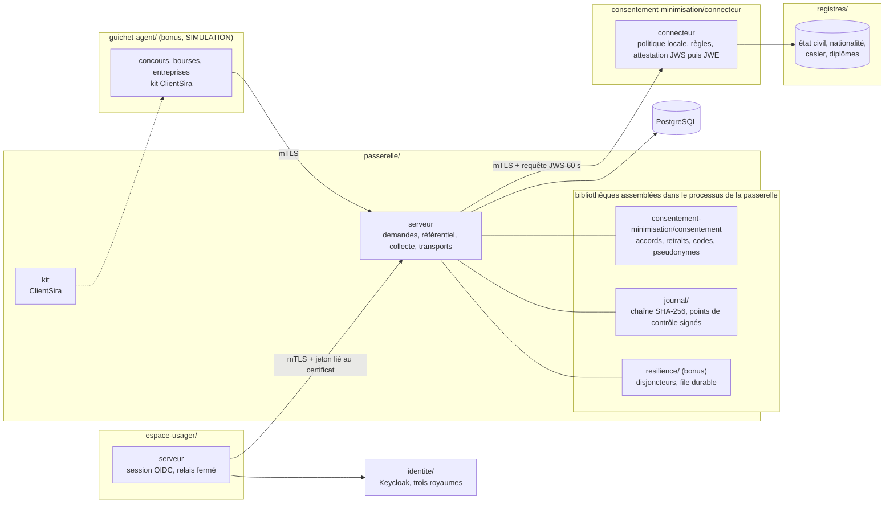

# Rapport technique de Sira

Finale du hackathon, sujet 02 « Dites-le-nous une fois ». Équipe « codeforchange », IBAM Ouagadougou.

Ce rapport répond aux livrables écrits du sujet : architecture, démarches couvertes, tests d'interopérabilité, conformité à la protection des données personnelles, ainsi que contexte, choix, résultats et limites. Il renvoie au code et aux tests pour chaque affirmation vérifiable. La contribution de chaque membre et les briques réutilisées sont dans la [matrice de contribution](matrice-contribution.md).

## 1. Contexte

Pour une démarche administrative, l'usager va aujourd'hui de guichet en guichet chercher des pièces (extrait de naissance, certificat de nationalité, casier judiciaire), puis les redépose ailleurs. Le sujet demande l'inverse : faire circuler les pièces entre administrations, dans le respect des droits des personnes sur leurs données.

Sira (« la route » en dioula) est un socle libre d'interopérabilité. Le service qui instruit une démarche pose des questions fermées aux registres qui détiennent l'information, après l'accord de l'usager. Le registre répond le strict nécessaire (« majeur : oui », pas la date de naissance), signe sa réponse et la chiffre pour ce seul service. Chaque consultation est inscrite dans un journal que l'usager lit depuis son espace. Si un registre tombe, le dossier est enregistré quand même et se complète au retour du registre.

Le cadre légal de référence est la loi n° 001-2021/AN du 30 mars 2021 portant protection des personnes à l'égard du traitement des données à caractère personnel (section 6).

Toutes les personnes, administrations et données de la démonstration sont fictives. Le jury doit publier un contrat commun des trois registres (OpenAPI) et une liste de citoyens fictifs : ils n'étaient pas publiés à la date de ce rapport. Sira utilise donc ses propres registres simulés et ses propres personnes fictives.

## 2. Architecture

### 2.1 Un dossier par couche

Le dépôt suit l'architecture imposée. Le [README du dépôt](../../README.md) donne pour chaque couche son dossier, sa spécification OpenAPI et sa commande de test.

Hors couches : `commun/` (briques Java partagées : mTLS, JOSE, OIDC, erreurs), `console/` (administration du socle), `identite/`, `pki/`, `interfaces/` (écrans Angular), `deploiement/` (Docker Compose), `tests/e2e/`.

| Couche | Dossier | Module Maven | Rôle |
|---|---|---|---|
| Registres | `registres/` | `sira-demo-registre` | Registre générique simulé, lancé une fois par registre, avec ses données fictives et un panneau de pannes |
| Passerelle d'échange | `passerelle/` | `sira-passerelle`, `sira-kit` | Point de passage unique : référentiel (membres, registres, questions, démarches, habilitations), demandes, collecte auprès des connecteurs, kit des services |
| Consentement et minimisation | `consentement-minimisation/` | `sira-consentement`, `sira-connecteur` | Accord du citoyen, retrait, pseudonymes par service ; connecteur posé chez chaque administration, qui évalue la règle et ne rend que la réponse |
| Journal de traçabilité | `journal/` | `sira-journal` | Journal en ajout seul, chaîné, avec points de contrôle signés ; lecture et signalement par le citoyen |
| Espace usager | `espace-usager/` | `sira-espace-citoyen` | Session du citoyen et relais vers la passerelle ; écrans dans `interfaces/socle/projects/espace-citoyen` |
| Guichet agent (bonus) | `guichet-agent/` | `sira-demo-service` | Trois services simulés, un par démarche, côté usager et côté agent |
| Résilience (bonus) | `resilience/` | `sira-resilience` | Disjoncteur, cloison et nouveaux essais par registre ; file d'attente durable |

### 2.2 Le chemin d'une demande

1. Le service ouvre une demande auprès de la passerelle (`POST /v1/demandes`, mTLS). La passerelle vérifie que le service est habilité pour cette démarche.
2. Le citoyen se connecte à son espace avec son identifiant unique et un code à usage unique, puis lit la finalité et les questions, et accepte ou refuse.
3. Pour chaque question, la passerelle envoie au connecteur du registre une requête signée (JWS ES256, 60 secondes, `jti` à usage unique).
4. Le connecteur applique sa politique locale, lit la fiche dans le registre, évalue la règle, puis signe l'attestation avec le cachet du registre et la chiffre pour le seul service demandeur.
5. La passerelle remet l'attestation sans pouvoir la lire. Le service la déchiffre et vérifie qu'elle vient du bon registre et concerne la bonne démarche, la bonne question et le bon pseudonyme.
6. Chaque étape est inscrite au journal, sans aucune valeur transmise.

Le détail, fichier par fichier, est dans [comprendre.md](../comprendre.md). Les règles communes sont dans le [contrat d'architecture](../architecture/CONTRAT.md).

## 3. Choix et raisons

| Choix | Raison |
|---|---|
| La règle est évaluée dans le connecteur, chez l'administration qui détient le registre | La minimisation est réelle : la date de naissance ne quitte jamais l'administration, seule la réponse « oui » ou « non » sort. |
| La politique locale du connecteur prime sur la passerelle | Chaque administration reste maîtresse de ce qu'elle expose. Une habilitation centrale ne peut pas forcer un champ que le registre n'a pas ouvert. |
| Attestation signée par le registre puis chiffrée pour le service | La passerelle transporte sans lire. Un administrateur indiscret ou une passerelle compromise ne voient pas les réponses. |
| Pseudonyme HMAC-SHA-256 propre à chaque service | Deux services ne peuvent pas recouper leurs fichiers. L'identifiant unique ne sort de la passerelle que vers les connecteurs. |
| Journal, consentement et résilience assemblés dans le processus de la passerelle | L'accord, l'échange et la ligne de journal s'écrivent dans une seule transaction : aucune consultation sans trace. Chaque couche garde son module et ses tests. |
| File d'attente durable dans PostgreSQL (`FOR UPDATE SKIP LOCKED`) | La reprise après panne n'ajoute pas de courtier de messages à exploiter. |
| Trois royaumes Keycloak étanches (citoyens, socle, agents simulés) | Un citoyen ne peut pas ouvrir la console, un agent ne peut pas ouvrir l'espace citoyen. |
| Aucun jeton dans le navigateur, jeton lié au certificat du serveur | Un jeton volé est inutilisable ailleurs. |
| Transport derrière une interface : liaison directe mTLS | Une autre route (X-Road par exemple) se brancherait sans changer les garanties. |
| Cryptographie par bibliothèques reconnues (JDK, Nimbus JOSE+JWT, Keycloak) | Aucun algorithme de sécurité maison. |
| Séparation socle / démonstration | Ce qu'une administration réutiliserait ne contient aucun compte fictif. `scripts/sira demarrer` lance le socle seul. |
| Déploiement en une commande (`scripts/sira demo`), secrets générés au premier démarrage | Le jury relance tout sans configuration, et aucun secret n'est dans le dépôt. |
| Licence EUPL-1.2 | Licence libre copyleft publiée par l'Union européenne, rédigée pour les administrations et disponible en français. |

## 4. Démarches couvertes

Les démarches sont déclarées dans le référentiel de la passerelle, chargé au premier démarrage de la démonstration depuis `passerelle/amorcage-demo/complet.yaml`. Chacune a une finalité, une base légale, un service et une durée d'autorisation. Dans les trois cas, l'usager ne fournit aucune pièce : l'écran du service l'annonce (« Vous n'avez aucune pièce à fournir »).

### 4.1 Inscription à un concours direct de la fonction publique

| | |
|---|---|
| Code | `concours-direct`, service `concours` |
| Finalité | « Vérifier vos conditions d'inscription au concours. » |
| Base légale déclarée | Loi n° 081-2015/CNT portant statut général de la fonction publique d'État |
| Questions habilitées | `etat-civil.majeur`, `etat-civil.age-35-au-plus`, `nationalite.burkinabe`, `casier.neant` : quatre réponses par oui ou non |
| Autorisation | 30 jours |
| Pièces évitées | Extrait de naissance, certificat de nationalité, bulletin du casier judiciaire |
| Test de bout en bout | `tests/e2e/scenarios/parcours/parcours-cles.spec.ts` : « le concours apprend « majeur : oui », jamais la date de naissance », et le scénario du casier muet |

Un « non » ne rejette jamais un dossier automatiquement : le dossier passe « à examiner » par un agent.

### 4.2 Demande de bourse d'études

| | |
|---|---|
| Code | `bourse-etudes`, service `bourses` |
| Finalité | « Constituer votre dossier de bourse. » |
| Base légale déclarée | « Décret portant régime des bourses d'études (référence de démonstration) » : référence fictive, à remplacer par le texte réel |
| Questions habilitées | `nationalite.burkinabe` (oui ou non), `etat-civil.identite` (nom, prénoms, date de naissance), `diplomes.baccalaureat` (oui ou non), `diplomes.attestation` (attestation de diplôme en PDF) |
| Autorisation | 90 jours |
| Pièces évitées | Pièce d'identité ou extrait de naissance, certificat de nationalité, attestation du baccalauréat |
| Test de bout en bout | `tests/e2e/scenarios/parcours/parcours-cles.spec.ts` : « le service reçoit l'identité, le baccalauréat et l'attestation en PDF » |

Cette démarche montre les trois niveaux de réponse : `STATUT` (oui ou non), `CHAMPS` (quelques champs nommés) et `DOCUMENT` (une pièce signée par le registre, quand la démarche l'exige vraiment).

### 4.3 Immatriculation d'un commerçant au registre du commerce

| | |
|---|---|
| Code | `immatriculation-commercant`, service `entreprises` (« Créer son entreprise ») |
| Finalité | « Immatriculer votre entreprise individuelle. » |
| Base légale déclarée | Acte uniforme OHADA relatif au droit commercial général du 15 décembre 2010, articles 7 (capacité), 10 (interdictions) et 44 (pièces de l'immatriculation d'une personne physique) |
| Questions habilitées | `etat-civil.identite` (nom, prénoms, date de naissance), `nationalite.burkinabe` (oui ou non), `casier.neant` (oui ou non) : une question à chacun des trois registres du sujet |
| Autorisation | 30 jours |
| Pièces évitées | Extrait d'acte de naissance, certificat de nationalité, bulletin n° 3 du casier judiciaire |
| Test de bout en bout | `tests/e2e/scenarios/parcours/demarches.spec.ts` : « les trois registres répondent, le service ne reçoit que l'utile » |

**Pourquoi cette démarche plutôt que le passeport.** Le passeport ne demande que l'état civil et la nationalité : interroger le casier pour le délivrer serait une collecte excessive, contraire au principe de minimisation. L'immatriculation d'un commerçant, elle, a besoin des trois registres. Le registre du commerce inscrit l'identité du commerçant, sa date de naissance établit qu'il n'est pas mineur (article 7), la nationalité décide du régime applicable, et le casier remplace l'extrait demandé à l'immatriculation (articles 10 et 44).

**Ce qui est transmis, et rien de plus.** Seule l'identité passe au niveau `CHAMPS`, parce que le registre du commerce l'inscrit. La date de naissance étant déjà transmise, une question « majeur » ferait doublon : elle n'est pas habilitée. La nationalité et le casier restent au niveau `STATUT`. Le service n'apprend jamais quelle autre nationalité la personne aurait, ni le contenu du casier, ni le lieu de naissance. Un « non » du casier ne refuse pas l'immatriculation : toutes les condamnations n'entraînent pas l'interdiction de l'article 10, et le dossier passe « à examiner » par un agent.

**Comment elle est construite.** Aucune ligne de code propre à la démarche. Le serveur des services simulés (`guichet-agent/serveur`) est lancé une troisième fois avec le profil `entreprises` (`application-entreprises.yaml`). La démarche, ses questions et son habilitation approuvée sont déclarées à l'amorçage (`passerelle/amorcage-demo/complet.yaml`). L'adresse http://entreprises.sira.localhost:8600 est servie par le proxy, et l'agent `agent.entreprises@sira.example` ouvre le back-office. `ProfilsTest` vérifie que chaque profil du serveur s'accorde avec l'amorçage : même service, même nom, démarche habilitée.

## 5. Tests d'interopérabilité

Les tests ci-dessous existent dans le dépôt. Les commandes sont celles de `scripts/sira` et du wrapper Maven.

| Ce qui est éprouvé | Où | Comment le lancer |
|---|---|---|
| Parcours complets entre services, passerelle, connecteurs, registres, identité et espace usager, à travers le vrai proxy et de vrais navigateurs | `tests/e2e/scenarios/` : `ossature/` (identité, téléphone simulé), `parcours/` (épreuves, accords, console, séparation des populations), `socle/` (socle seul) | `scripts/sira tester` sur la pile qui tourne |
| Refus : sans certificat, avec un certificat étranger, mauvais rôle, requête rejouée, modifiée ou expirée, attestation pour un autre service, habilitation absente, royaumes croisés | Classes `RefusTest` de `passerelle/serveur` et de `consentement-minimisation/connecteur`, `JoseTest`, `AutreRoyaumeTest` | `./mvnw -ntp verify` (Docker requis pour Testcontainers) |
| Ce qui doit rester fermé sur la pile réelle : réseaux internes, en-têtes HTTP, durcissement de chaque conteneur, connexion du citoyen (sixième essai refusé, même page pour un identifiant inconnu, freinage) | `scripts/verifier` | `scripts/sira verifier` |
| Raccordement d'un service tiers par le kit : un service ne connaît que `ClientSira` et ses certificats | `passerelle/kit` (`ClientSiraTest`), `guichet-agent/serveur` (tests contre une fausse passerelle mTLS) | `./mvnw -q -ntp verify -pl passerelle/kit,guichet-agent/serveur -am` |
| Cohérence entre référentiel, politiques locales et données des registres | `AmorcageTest` (`registres/serveur`) | `./mvnw -q -ntp verify -pl registres/serveur -am` |
| Brancher le registre d'une autre équipe | Procédure dans [brancher-un-registre.md](../brancher-un-registre.md) ; rejouée sur un registre d'exemple par `tests/e2e/scenarios/etranger/registre-etranger.spec.ts` | `scripts/sira etranger` sur la démonstration qui tourne |

Ce qui n'est pas encore éprouvé :

- la conformité au contrat commun des registres du jury, qui n'est pas publié ;
- le branchement d'un registre réellement tenu par une autre équipe : il ne peut se faire que le jour de l'épreuve ;

## 6. Conformité à la protection des données personnelles

Sira n'est **pas** déclaré conforme et n'a fait l'objet d'aucune démarche auprès de l'autorité de contrôle. Cette section dit, principe par principe, ce que le prototype met en œuvre techniquement et ce qu'un déploiement réel demanderait encore. Les articles cités sont ceux de la loi n° 001-2021/AN, lue dans le texte publié par l'Assemblée nationale.

### 6.1 L'autorité de contrôle

L'autorité de contrôle est la Commission de l'informatique et des libertés (CIL). Selon la presse, une loi votée en août 2026 la fusionne avec le Conseil supérieur de la communication au sein d'une nouvelle autorité, l'ARCOD ; la promulgation n'est pas confirmée. Sira écrit donc « l'autorité de contrôle (la CIL, en cours de fusion au sein de l'ARCOD) ».

Pour un déploiement réel, son rôle serait central :

- **avis motivé** sur l'acte réglementaire qui créerait le traitement pour le compte de l'État (article 30) ;
- **autorisation** de l'interconnexion de fichiers et de l'usage d'un numéro national d'identification (article 31) : Sira relève de ces deux cas ;
- contrôle et réception des plaintes des personnes, que l'espace citoyen mentionne dans sa page « Vos droits ».

### 6.2 Principe par principe

| Principe (articles) | Ce que Sira met en œuvre | Ce qui resterait à faire |
|---|---|---|
| **Finalité** déterminée, explicite et légitime (8) | Chaque démarche porte une finalité et une base légale dans le référentiel. La finalité est montrée au citoyen avant l'accord et inscrite dans chaque ligne du journal. Un service n'obtient que les questions de son habilitation, approuvée par l'autorité et non par l'instructeur qui l'a préparée. | Faire reposer chaque démarche sur un texte réel : la base légale de la bourse est une référence de démonstration. Contrôler a posteriori l'usage fait par les services. |
| **Minimisation** : données adéquates, pertinentes et non excessives (8), principe de pertinence de l'interconnexion (41) | La règle est évaluée chez le registre ; au niveau `STATUT`, seul un booléen sort. La politique locale du connecteur refuse tout champ qu'elle ne liste pas. Le casier ne répond que « vierge : oui ou non ». Le journal ne contient jamais de valeur. Chaque service reçoit un pseudonyme propre, jamais l'identifiant unique. | Justifier chaque niveau `CHAMPS` ou `DOCUMENT` (l'attestation de diplôme de la bourse est un PDF complet) et le faire valider. Fixer les durées de conservation chez les services. |
| **Consentement** (12, 13) | Rien ne part sans un accord explicite donné dans l'espace citoyen, question par question affichée, pour une durée bornée (30 jours pour le concours, 90 pour la bourse). Une demande qui désigne la personne par son identifiant tapé n'est jamais acceptée d'office. Avec un code court, le code de vérification affiché par le service est exigé. | Pour une administration, la base du traitement est souvent la mission d'intérêt public (article 13) : le consentement de Sira est alors une garantie de plus, pas la seule base. Organiser l'alternative pour qui refuse (pièces papier). Faire préciser le consentement exprès exigé pour le casier (article 12). |
| **Information** de la personne (14, 16) | L'écran d'accord indique le service, la démarche, la finalité, chaque question et ce que le service recevra. La page « Vos droits » de l'espace citoyen explique les droits et l'autorité à saisir. | Ajouter sur l'écran d'accord l'identité du responsable de traitement, la durée de conservation et les destinataires, que l'article 16 exige. |
| **Droit d'accès** (17) | Le citoyen lit dans son historique, « Qui a consulté mes informations », chaque demande, accord, consultation, réutilisation, refus, échec et retrait qui le concerne. | Délivrer une copie (export de l'historique) et organiser la consultation sur place pour qui n'a pas d'accès en ligne. |
| **Retrait et opposition** (20) | Le citoyen retire un accès depuis `/acces` : effet immédiat, attestations encore en dépôt purgées, plus rien n'est servi sous cet accord. Le retrait est journalisé. | Ce qui a déjà été transmis reste chez le service : la suppression se demande au service, ce que la page « Vos droits » dit. Prévoir la réponse motivée d'une administration qui maintient un traitement obligatoire. |
| **Décision automatisée et contestation** (15, 19) | Un « non » ne rejette jamais un dossier seul : il passe « à examiner » par un agent. Le citoyen peut signaler une ligne de son journal ; la console liste les signalements. | Fixer qui traite les signalements, dans quel délai, et comment la réponse revient au citoyen. |
| **Rectification** (21) | Sira ne garde pas les données des registres : il les lit à la source. La page « Vos droits » renvoie vers l'administration qui détient l'information. | Acheminer la demande de rectification vers le registre source et suivre le délai de deux mois. |
| **Sécurité et confidentialité** (10, 24) | mTLS TLS 1.3 entre toutes les machines, identité tirée du certificat ; requêtes JWS ; attestations JWS puis JWE ; trois royaumes étanches ; séparation des rôles ; conteneurs durcis ; aucun secret dans le dépôt. Détail et tests dans [securite.md](../securite.md). | Clés en HSM, révocation des certificats, frontal HTTPS, hébergement souverain, sauvegardes, supervision. |
| **Traçabilité** | Journal en ajout seul (la base refuse modification et effacement), chaîné par SHA-256, avec points de contrôle signés ; la console recalcule la chaîne (« Vérifier l'intégrité »). Le connecteur tient aussi son propre journal, sans valeur ni identifiant. | Fixer la durée de conservation du journal et son accès par l'autorité de contrôle. |
| **Transfert à l'étranger** (42) | Toute la pile tourne sur un seul poste ; aucun appel à un service externe. | Choisir un hébergement sur le territoire. |

Le journal consultable, le retrait et la minimisation sont une base technique pour respecter la loi. Ils ne remplacent ni l'avis ni l'autorisation de l'autorité de contrôle, ni la désignation d'un responsable de traitement dans chaque administration.

## 7. Résultats

Mesures relevées le 17 novembre 2026 sur le poste de développement, après la réorganisation en un dossier par couche :

| Mesure | Résultat |
|---|---|
| `./mvnw -ntp -o clean verify` | Succès : 12 modules, 440 tests, 0 échec ; mise en forme contrôlée par Spotless |
| `scripts/sira reinitialiser --oui` puis `scripts/sira demo`, à froid | Code de sortie 0 en 4 minutes ; les 28 conteneurs `sira-*` sont sains |
| `scripts/sira verifier` | « tout est fermé » : 58 contrôles réussis |
| `scripts/sira tester` | 28 tests de bout en bout sur 28 |

Ce que la démonstration montre :

- **ne transmettre que l'utile :** le concours reçoit « majeur : oui », et la date de naissance n'apparaît ni à l'écran, ni dans les attestations reçues, ni chez l'agent ;
- **retrouver chaque consultation :** l'historique du citoyen montre le service, le registre, la question, le résultat et l'accord qui l'a permise ;
- **tenir quand un registre tombe :** casier muet, le dossier est enregistré à l'état `PARTIELLE`, puis se complète seul en 180 secondes au plus après le retour du registre ;
- **raccorder sans code :** une question se crée, s'essaie sur une personne fictive et s'habilite depuis la console, avec séparation entre l'instructeur et l'autorité.

## 8. Limites

- **Données du jury.** Le contrat commun des registres et la liste de citoyens fictifs du jury ne sont pas publiés : les registres et les personnes sont ceux de Sira. L'écart éventuel avec l'API de registre lue par le connecteur (contrat §9) reste à traiter à leur publication.
- **Spécifications OpenAPI.** Chaque couche reçoit sa spécification dans son dossier (`<couche>/openapi.yaml`) ; le détail des routes est aussi décrit dans [API.md](../architecture/API.md) et dans le [contrat](../architecture/CONTRAT.md).
- **Une base partagée.** Journal, consentement et résilience sont des modules séparés, mais partagent la base de la passerelle ; leurs tables sont créées par la migration Flyway de `passerelle/serveur`, sans schéma séparé.
- **Tests de bout en bout des couches assemblées.** Les tests qui demandent une base pour le journal, le consentement et la résilience (`JournalTest`, `RefusTest`, `ResilienceTest`) sont dans `passerelle/serveur`.
- **Écrans de l'espace usager.** Le dossier `espace-usager/` contient le serveur ; les écrans sont dans `interfaces/socle/projects/espace-citoyen`.
- **HTTP en local.** La pile est servie en HTTP sur `127.0.0.1` ; le frontal TLS de production n'est pas fourni.
- **Clés.** Fichiers dans un volume Docker, sans HSM ni révocation en ligne ; certificats de 90 jours.
- **Codes de connexion.** Pas de vrai SMS : le code arrive sur un téléphone simulé (Mailpit). Un citoyen reçoit au plus dix codes par heure.
- **Conformité.** Aucune démarche auprès de l'autorité de contrôle (section 6).
